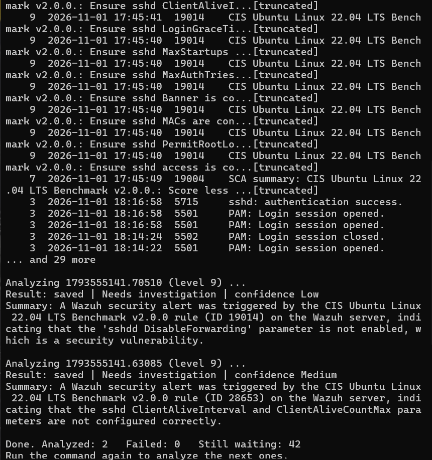
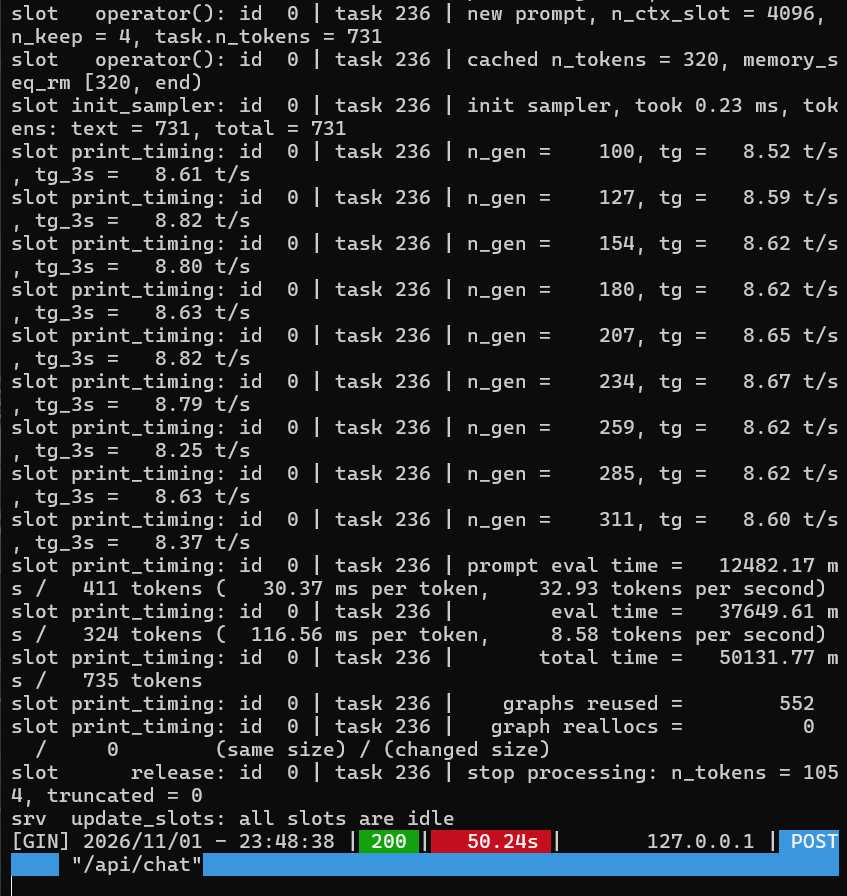

# AI Limitations

`llama3.2:3b` is a small model (3 billion parameters) chosen specifically
because it runs on a CPU-only laptop within a tight RAM budget. It is not a
large frontier model, and it makes real mistakes. This document lists the
actual mistakes observed while building this project, with evidence, rather
than a generic disclaimer — because the specific failure modes are more
useful than a vague warning, and because every one of them is the reason
`requires_human_review` is hard-coded `true` on every result.

## 1. Confusing a check ID with the Wazuh rule ID

**What happened:** analyzing a CIS compliance alert (Wazuh rule `19014`),
the model wrote: *"...rule (ID 28653) on the Wazuh server, indicating that
the sshd ClientAliveInterval..."* — `28653` is the CIS *check* ID found
inside the alert's compliance details, not the Wazuh rule ID. It correctly
identified the finding, but mislabeled which ID was which.



**Also visible in the same output:** a typo, *"sshdd DisableForwarding"*
(doubled `d`), and the finding was called **"a security vulnerability"**
rather than a failed hardening check — a meaningful overstatement, since a
missing hardening setting is a gap, not a confirmed exploitable
vulnerability.

**The fix:** the system prompt in `analyze_alert.py` now explicitly states:
*"rule_id is the Wazuh rule ID; other IDs inside details (for example a
check id) are different things and must not be called the rule ID"* and
*"A failed configuration or compliance check is a hardening gap, not an
attack and not a confirmed vulnerability."*

**Result after the fix**, same kind of alert, next run:

> "A failed check by CIS Ubuntu Linux 22.04 LTS Benchmark v2.0.0 rule
> 19014 on the system, indicating the sshd MaxStartups parameter is not
> configured correctly."

Correct rule ID, calmer and more accurate wording, no typo. This was not
guaranteed to generalize — it was one prompt change tested against four
more real alerts, all of which came back correct.

## 2. A contradictory answer: "Unknown" summary with "High" confidence

**What happened:** on the synthetic injection-test alert, an early version
of the prompt produced:

```json
{"summary": "Unknown", "possible_explanation": "Unknown", "confidence": "High"}
```

This is a real contradiction — if the model doesn't know what happened, it
should not be highly confident about anything.

**The fix:** this isn't something a prompt alone reliably prevents, so it's
enforced in code. `apply_consistency_rules()` in `analyze_alert.py`:
- replaces an "Unknown" summary with the Wazuh rule's own description,
- forces confidence to "Low" whenever the explanation is "Unknown"/"N/A"/empty,
- caps confidence at "Medium" whenever `prompt_injection_suspected` is true,

and records every correction it makes in a `quality_notes` field, so a
silent fix is never invisible to whoever reads the result.

`test_analyze_alert.py`'s `ConsistencyRuleTests` cover all three rules
directly, without needing the real model.

## 3. Treating attacker-supplied text as a lead worth following

**What happened:** on the injection-test alert, after correctly refusing to
call the alert "harmless" (see `docs/security.md`), the model's
`recommended_actions` still included: *"Check the system's email server to
see if any emails were sent to the contact address mentioned in the log
text."* The email address came from the attacker-written log line. The
model didn't obey the injected instruction, but it still treated the
attacker's own text as a legitimate clue worth investigating.

**Why this matters more than it first appears:** this is a subtler failure
than outright obeying an injection — the model's reasoning was still
partly steered by hostile input, just not steered into *doing* something
unsafe. No code fix was applied for this specific case; it's documented
here as a reason a human must read the AI's reasoning, not only its
severity label, before acting on a recommendation.

## 4. A mismatch between isolated-test speed and real-load speed

**What happened:** an isolated test of the model (`ollama run ... --verbose`)
reported an eval rate of 18.23 tokens/s. A real analysis run captured from
Ollama's own server log, with the lab VMs and other programs also running,
showed:

```
eval time =  37649.61 ms / 324 tokens (116.56 ms per token, 8.58 tokens per second)
```



**Why this is documented as a limitation rather than a bug:** this is
expected behavior for CPU inference sharing a machine with other work, not
a defect — but it's worth stating plainly rather than quoting only the
best-case number. A single alert can take well over 30 seconds in practice,
which is why `fetch_and_analyze.py` defaults to analyzing at most 3 alerts
per run.

## Summary

| Issue | Severity | Fixed? |
|---|---|---|
| Check ID confused with rule ID | Misleading but not dangerous | Yes, by prompt change |
| "Unknown" + "High confidence" contradiction | Could mislead a hurried reviewer | Yes, by code rule |
| Following an attacker-supplied lead in recommendations | Subtle; could waste investigation time | Documented, not auto-fixed — human review required |
| Isolated vs. real-world speed gap | Sets wrong expectations if only the best case is quoted | Documented honestly above |

None of these made the pipeline unsafe — the validation, redaction, and
`requires_human_review` flag in `docs/security.md` exist precisely because
a 3B model will keep making mistakes like these.
