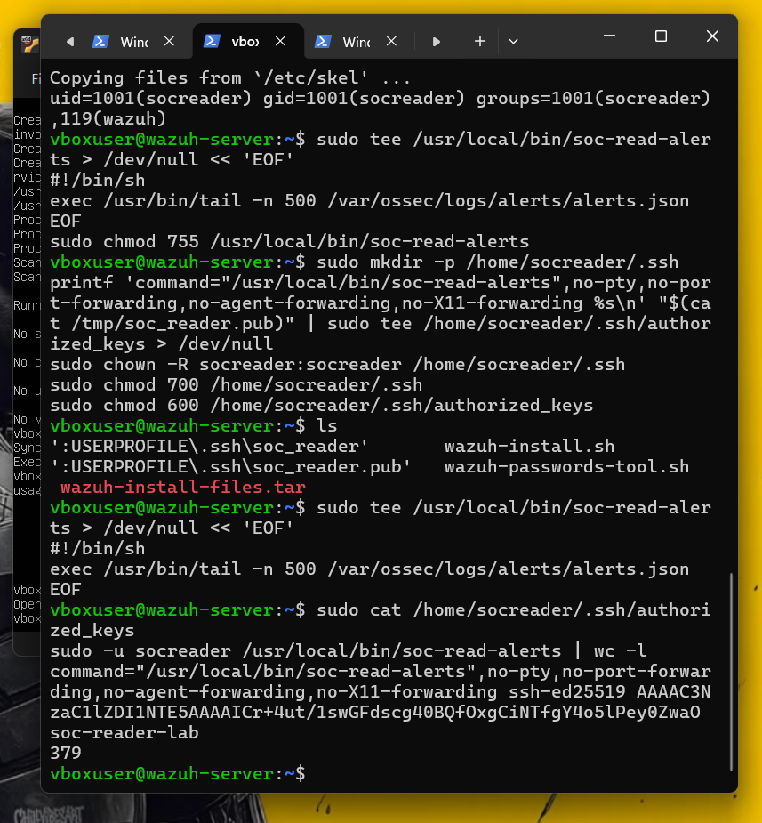

# Network Setup

This project needs one new piece of network configuration beyond what
`wazuh-home-soc-lab` already has: a way for the Windows host to read recent
alerts from `wazuh-server`, without exposing anything else on that VM.

## Why SSH with a forced command, and not the Wazuh API

Wazuh ships a REST API that can return alerts. It was considered and
rejected for this project in favor of a restricted SSH key, for one reason:
**a forced-command SSH key can do exactly one thing — print the last 500
alert lines — and nothing else, even if the key is stolen.** An API
account, even a "read-only" one, generally has a broader permission surface
(querying agents, manager status, and more) and needs its own credential
and token-refresh handling. For a single-analyst home lab reading a handful
of alerts at a time, the smaller, simpler, and more restrictive option won.
This is documented as a deliberate trade-off, not the only valid choice —
see `docs/security.md` for the full reasoning.

## The two layers

```
Windows host ──(1. port forward)──► VirtualBox NAT network "soc-lab" ──► wazuh-server:22
                                                                              │
                                                                     (2. forced command)
                                                                              ▼
                                                                  tail -n 500 alerts.json
```

### 1. The VirtualBox port forward

`wazuh-server` lives on the isolated `soc-lab` NAT network
(`10.0.3.0/24`), not directly reachable from Windows. A port forward rule
maps a local port to it:

| Name | Protocol | Host IP | Host port | Guest IP | Guest port |
|---|---|---|---|---|---|
| wazuh-ssh | TCP | 127.0.0.1 | 2222 | 10.0.3.9 (server's current IP) | 22 |

Like the existing `8443` → dashboard rule, this only listens on
`127.0.0.1` — nothing outside the host machine can reach it. If the
server's IP changes after a rebuild (DHCP), this rule's Guest IP must be
updated to match (`ip -br a` on the server shows the current one).

### 2. The restricted `socreader` account

On `wazuh-server`:

```bash
sudo adduser --disabled-password --gecos "" socreader
sudo usermod -aG wazuh socreader
```

- `--disabled-password` — no password login is possible at all, only the
  one installed key.
- In the `wazuh` group, not `sudo` — enough to read the alerts file, no
  more.

The one command this account is ever allowed to run:

```bash
sudo tee /usr/local/bin/soc-read-alerts > /dev/null << 'EOF'
#!/bin/sh
exec /usr/bin/tail -n 500 /var/ossec/logs/alerts/alerts.json
EOF
sudo chmod 755 /usr/local/bin/soc-read-alerts
```

And the key is installed locked to exactly that command:

```
command="/usr/local/bin/soc-read-alerts",no-pty,no-port-forwarding,no-agent-forwarding,no-X11-forwarding ssh-ed25519 AAAA... soc-reader-lab
```

Each flag matters:

| Flag | What it blocks |
|---|---|
| `command="..."` | Whatever command the client asks for is ignored; this one always runs instead |
| `no-pty` | No interactive shell/terminal |
| `no-port-forwarding` | The key can't be used to tunnel other traffic through the server |
| `no-agent-forwarding` | Can't forward SSH agent credentials |
| `no-X11-forwarding` | No GUI forwarding |

### Generating and installing the key (Windows side)

```powershell
ssh-keygen -t ed25519 -f "$env:USERPROFILE\.ssh\soc_reader" -C soc-reader-lab
# empty passphrase — this key is used unattended by a script
scp -P 2222 "$env:USERPROFILE\.ssh\soc_reader.pub" vboxuser@127.0.0.1:/tmp/soc_reader.pub
```

Then on the server, the public key is placed in
`/home/socreader/.ssh/authorized_keys` with the restrictions above (see
`docs/installation-guide.md` for the exact commands), and the temporary
copy in `/tmp` is deleted.

**The private key (`soc_reader`, no extension) never leaves `~/.ssh` on the
Windows host and is never copied into the project folder** — it's excluded
from the repo by `.gitignore` as a second safety net, but the real
protection is that it's simply never placed there.

## Proof it works as intended

Two tests confirm the restriction, not just the connection:

```powershell
# 1. Reading alerts works
ssh -i "$env:USERPROFILE\.ssh\soc_reader" -p 2222 socreader@127.0.0.1 | Measure-Object -Line
# -> a line count, e.g. 390

# 2. Nothing else works -- the server ignores the requested command
ssh -i "$env:USERPROFILE\.ssh\soc_reader" -p 2222 socreader@127.0.0.1 whoami | Measure-Object -Line
# -> the SAME kind of line count again, NOT the word "socreader"
```



If `whoami` had actually run, this would print one line containing
`socreader`. Instead the alert reader ran regardless of what was asked for
— confirming the forced command cannot be bypassed from the client side.

## Code-side protections

`fetch_and_analyze.py` adds defense in depth on top of the key itself:
- Calls `ssh` with a **fixed, hard-coded argument list** — no shell is
  invoked, so nothing received over the network can become a new command.
- `BatchMode=yes` — never silently waits for or sends a password.
- A byte limit on the response (5 MB) in case something unexpected floods
  the connection.
- Every line of output is treated as untrusted text: parsed as JSON,
  and anything that isn't a valid alert object is counted and discarded,
  never passed through as-is.

See `docs/security.md` for the full threat model this fits into.
