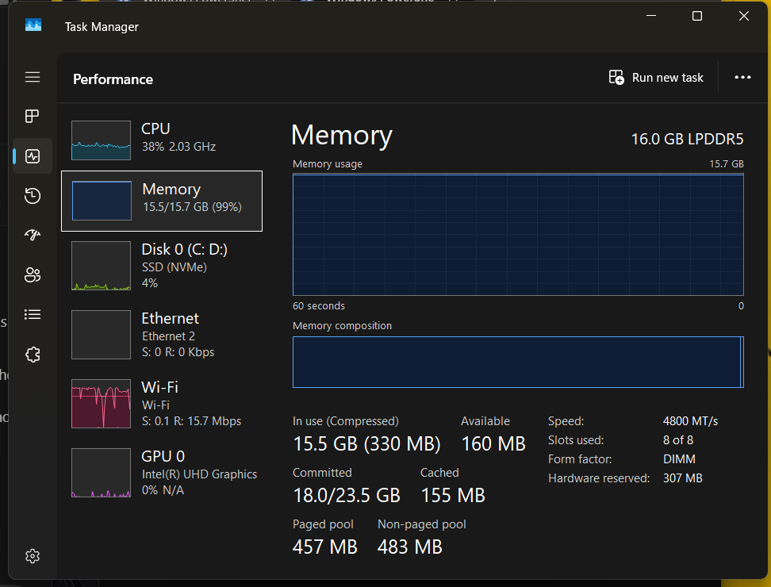
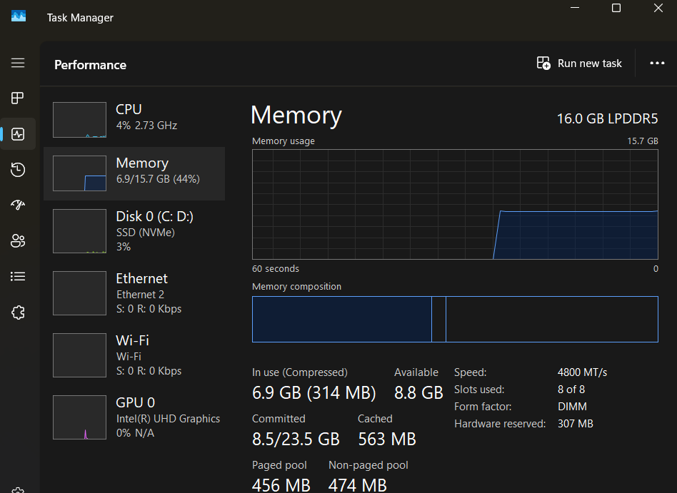

# Troubleshooting

Every problem below is a real one hit while building this project, not a
hypothetical — kept here with the actual fix, because the fix itself is
often more instructive than a generic FAQ entry.

## RAM: "everything is slow" / "RAM full" even with VMs off

This was the single biggest recurring problem on a 16 GB, no-GPU laptop.

**Background:** running all three lab VMs *and* the AI model at once
doesn't fit. The actual budget looked like this:

| Mode | What's running | Approx. RAM |
|---|---|---|
| Windows baseline alone | — | ~4.5–8.6 GB (varies — see below) |
| + `wazuh-server` | manager + indexer + dashboard | + ~4 GB |
| + AI model loaded | `llama3.2:3b` | + ~2.6 GB |
| + `ubuntu1` + `kali` | full attack demo, no AI | + ~4–8 GB more |



**The surprising cause, found twice:** "I shut everything down" didn't
always mean every VM was actually off. The fix was to stop guessing from
Task Manager's process list (which doesn't clearly separate VMs) and ask
VirtualBox directly:

```powershell
$vb = "C:\Program Files\Oracle\VirtualBox\VBoxManage.exe"
& $vb list runningvms
```

This showed exactly which VMs were still up when Task Manager alone wasn't
conclusive. The fix each time was a clean shutdown
(`sudo poweroff` inside the VM, not closing the window) of whatever wasn't
needed for the current task.

**After properly freeing the VMs:**



**Rule of thumb that resolved this for good:** never run all three VMs and
the AI model at the same time. Only `wazuh-server` is needed to fetch and
analyze alerts — `ubuntu1` and `kali` are only needed when generating new
attack traffic, and should be shut down again immediately afterward.

## `wazuh-indexer` fails to start after reducing server RAM

**Symptom:**

```
wazuh-indexer.service: start operation timed out. Terminating.
```

**Cause:** `wazuh-server` was set to 2048 MB to save memory. The indexer
(the component that stores and searches alerts) needs more than that to
start reliably.

**Fix:** set the server's Base Memory back to **4096 MB** (Settings →
System → Motherboard, VM powered off first). This is the practical minimum
found for a single-host Wazuh install in this lab — lower broke the
indexer every time it was tried.

## Ollama is storing models on `C:` instead of `D:`

**Symptom:** `OLLAMA_MODELS` is correctly set to `D:\ollama models`, but
`ollama list` shows nothing there, or `ollama pull` fills up `C:` instead.

**Cause:** Ollama's background tray app reads its environment only at
Windows sign-in. Setting the variable in a PowerShell window *after*
Ollama was already running does not reach it — only a full sign-out,
restart, or an **Explorer restart** (Task Manager → Windows Explorer →
Restart) refreshes what a Start-menu-launched app sees.

**Reliable fix without a restart:** start the server by hand in the window
where the variable was just set:

```powershell
Get-Process *ollama* | Stop-Process -Force
$env:OLLAMA_MODELS = "D:\ollama models"
ollama serve
```

Leave that window open; use a second window for everything else. Existing
files can be moved after stopping Ollama:

```powershell
Move-Item "$env:USERPROFILE\.ollama\models\*" "D:\ollama models\" -Force
```

## `python`/`ollama`/`py` "is not recognized"

**Cause, almost every time:** the command was typed in a PowerShell window
opened *before* the program was installed, or before a shell variable
(like `$app = "..."`) was set in that specific window. Variables and PATH
updates only apply to windows opened **after** the change.

**Fix:** open a brand new PowerShell window and try again. If a shortcut
variable like `$app` was used earlier in the session, it has to be set
again in any new window:

```powershell
$app = "D:\ai-powered-soc-monitoring-lab\ai-engine\app"
```

Or just use the full path every time instead of a shortcut.

## `ERROR: The alert is missing important fields: full_log`

**Cause:** not every Wazuh alert has a `full_log` text field — compliance
scan results (CIS benchmark checks, rule `19014`/`19004`) store their
facts under `data.sca...` instead, with no log line at all. An earlier
version of `parse_alert.py` required `full_log` unconditionally and
refused these alerts.

**Fix:** `parse_alert.py` now falls back to `flatten_details()`, which
turns the alert's `data` section into a list of short, cleaned `key:
value` facts whenever there's no log text, and only reports an alert as
unusable if it has *neither*. This was found by running the real fetch
pipeline against real compliance alerts, not anticipated in advance — a
useful reminder that real data finds gaps that invented test cases don't.

## Dashboard: "DASHBOARD_PASSWORD is not set"

**Cause:** the password lives only in the environment of the one
PowerShell window where it was set with `$env:DASHBOARD_PASSWORD = "..."`.
It does not persist to a new window, and is never saved to any file by
design (see `docs/security.md`).

**Fix:** set it again, in the same window you'll start the dashboard from:

```powershell
$env:DASHBOARD_PASSWORD = "your-password"
py dashboard\dashboard.py
```

## SSH: typing commands with nested quotes gets stuck

**Symptom:** a command with quotes inside quotes (e.g. a `grep` pattern
like `'"id":"100100"'`) leaves the terminal on a continuation `>` prompt
and never runs.

**Cause:** mismatched quote characters, easy to introduce when
copy-typing a complex command inside a VM console window (where paste can
also behave inconsistently).

**Fix:** press `Ctrl+C` to escape the stuck prompt, then prefer
quote-free alternatives — e.g. `grep -F 100100 file.json` instead of
`grep '"id":"100100"' file.json` — or edit the file directly with
`nano` instead of a one-line shell command.
